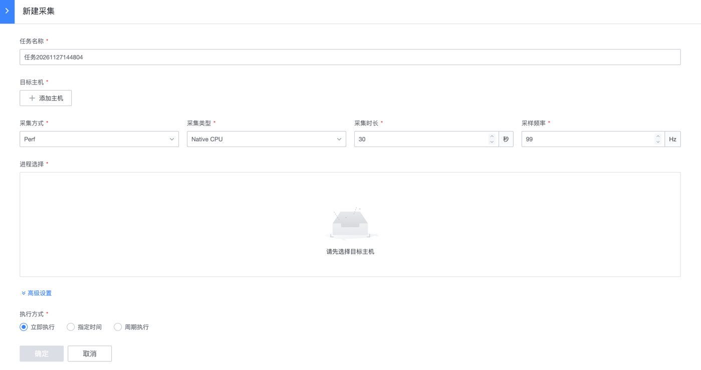
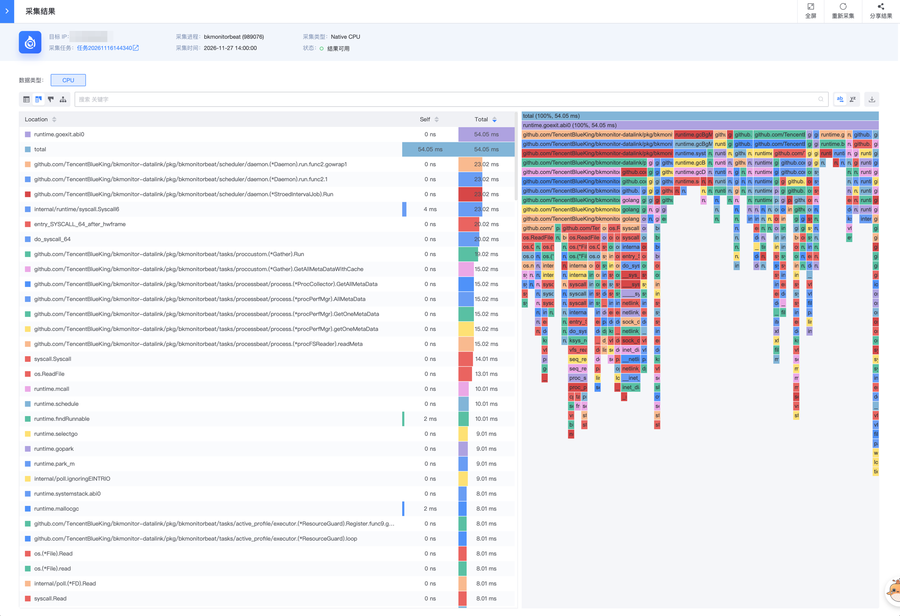

# Profiling 主动采集接入

## 1. 概述

Profiling 主动采集用于按需分析 Linux 主机上进程的性能问题：在观测平台选择目标主机和进程并配置采集参数，由主机上的监控采集器（bkmonitorbeat）完成采集，再通过火焰图、调用图等视图定位 CPU 热点与内存分配问题。

主动采集按需发起，适合排查突发的性能问题。如需对服务进行持续性能分析，可参考 <a href="https://github.com/TencentBlueKing/bkmonitor-ecosystem/tree/master/docs/open" target="_blank">各语言 Profiling SDK 接入</a>。

| 对比项 | 主动采集 | SDK 持续采集 |
| --- | --- | --- |
| 接入方式 | 在平台上发起采集：Perf 无需修改代码，Go 需要程序开启 pprof 端点 | 在程序中引入 Profiling SDK |
| 采集时机 | 按需执行：立即执行、指定时间或周期执行 | 程序运行期间持续采集 |
| 采集对象 | 主机上的进程 | 接入 SDK 的服务 |
| 数据上报 | bkmonitorbeat 经 GSE Agent 上报 | SDK 上报到 bk-collector |

### 1.1 工作原理

```text
观测平台「新建采集」
├── 立即执行：通过作业平台下发到目标主机，由 bkmonitorbeat 执行一次采集
└── 指定时间 / 周期执行：通过节点管理下发采集计划，由常驻的 bkmonitorbeat 按计划执行

bkmonitorbeat 采集结果 ──▶ GSE Agent ──▶ 观测平台「Profiling 结果」
```

## 2. 前置准备

### 2.1 术语介绍

* bkmonitorbeat：蓝鲸监控采集器，以插件形式运行在主机上，负责执行主动采集并上报结果。
* GSE Agent：蓝鲸管控平台 Agent，采集任务的下发与采集结果的上报都依赖它。
* <a href="https://man7.org/linux/man-pages/man1/perf-record.1.html" target="_blank">perf</a>：Linux 性能分析工具，「Perf」采集方式通过它对进程进行 CPU 采样。
* <a href="https://pkg.go.dev/net/http/pprof" target="_blank">pprof</a>：Go 官方的性能分析工具与数据格式，Go 程序引入 `net/http/pprof` 后可通过 HTTP 端点导出性能数据。
* 火焰图（Flame Graph）：以调用栈为纵轴、采样占比为横轴展示性能数据，函数越宽表示消耗越多。

### 2.2 采集方式

| 采集方式 | 采集类型 | 采集原理 | 适用场景 |
| --- | --- | --- | --- |
| Perf | Native CPU | 对目标进程执行 `perf record` 采样，经 `perf script` 转换为 pprof | C/C++、Rust、Go 等编译型语言进程的 CPU 热点分析 |
| Go | Go CPU | 请求目标进程的 `/debug/pprof/profile?seconds=<采集时长>` | Go 进程的 CPU 热点分析 |
| Go | Go Heap | 请求目标进程的 `/debug/pprof/heap`，获取内存分配快照 | Go 进程的内存分配分析 |

### 2.3 环境要求

| 检查项 | 要求 | 说明 |
| --- | --- | --- |
| 操作系统 | Linux | 采集由主机上的 bkmonitorbeat 执行，暂不支持其他操作系统。 |
| GSE Agent | 已安装且状态正常 | 安装可参考 <a href="https://bk.tencent.com/docs/markdown/ZH/Monitor/3.9/UserGuide/ProductFeatures/collectors/install.md" target="_blank">监控采集器安装</a>。 |
| bkmonitorbeat | 3.73.4937 及以上 | 版本过低可能出现采集失败或无数据上报，部署或升级可参考 <a href="https://bk.tencent.com/docs/markdown/ZH/Monitor/3.9/UserGuide/ProductFeatures/collectors/install.md" target="_blank">监控采集器安装</a>。 |
| perf | 已安装且与内核版本匹配 | 仅「Perf」采集方式需要，见「2.4 安装 perf」。 |
| Go pprof 端点 | 目标进程已开启 `net/http/pprof` | 仅「Go」采集方式需要，见「2.5 开启 Go pprof 端点」。 |

### 2.4 安装 perf（仅 Perf 采集方式）

使用 root 账号，根据主机操作系统执行安装命令：

| 发行版 | 安装命令 | 说明 |
| --- | --- | --- |
| TencentOS Server 4 | `dnf install -y perf` | 包版本与内核版本一致。 |
| TencentOS Server 2 / 3 | `yum install -y perf` | |
| CentOS / RHEL 7 | `yum install -y perf` | |
| CentOS Stream、RHEL、Rocky、AlmaLinux 8 及以上 | `dnf install -y perf` | |
| openEuler、银河麒麟 V10 | `dnf install -y perf` | 老版本使用 `yum`。 |
| Ubuntu | `apt-get update && apt-get install -y linux-tools-common linux-tools-$(uname -r)` | 必须与运行中的内核版本一致。 |
| Debian 11 及以上 | `apt-get install -y linux-perf` | |
| Debian 10 | `apt-get install -y linux-perf-4.19` | 包名带内核主次版本。 |
| SUSE / openSUSE | `zypper install -y perf` | |

### 2.5 开启 Go pprof 端点（仅 Go 采集方式）

「Go」采集方式由 bkmonitorbeat 在目标主机上通过 HTTP 读取进程的 pprof 端点，程序需引入 `net/http/pprof` 并监听本机端口。

建议 pprof 单独监听 `127.0.0.1`，避免端点对外暴露：

```go
import (
	"log"
	"net/http"
	_ "net/http/pprof" // 注册 /debug/pprof/ 系列路由
)

func main() {
	go func() {
		// ❗❗【非常重要】pprof 监听地址，需与采集任务中的「采集地址」「端口」一致
		log.Println(http.ListenAndServe("127.0.0.1:6060", nil))
	}()

	// 业务逻辑
}
```

* <a href="https://pkg.go.dev/net/http/pprof" target="_blank">net/http/pprof</a>

在目标主机上验证端点可访问，输出 `200` 即可：

```shell
curl -s -o /dev/null -w '%{http_code}\n' http://127.0.0.1:6060/debug/pprof/heap
```

* *引入 `net/http/pprof` 会把路由注册到 `http.DefaultServeMux`，如果业务服务也使用它对外提供服务，pprof 端点会一并暴露，建议业务服务使用独立的 `http.ServeMux`。*

## 3. 快速体验

以「Perf / Native CPU」为例，对主机上的进程立即发起一次采集，并查看火焰图。

### 3.1 开通主动采集

进入观测平台「数据探索 > Profiling 检索」，切换到「主动采集」。业务首次使用时会展示引导页，点击「立即采集」即可为当前业务开通主动采集。

开通后页面包含三个标签页：

| 标签页 | 用途 |
| --- | --- |
| Profiling 结果 | 以主机为维度，每台主机每次采集的结果对应一条记录，用于进入火焰图、表格、调用图等视图分析。 |
| 采集任务历史 | 以单次执行为维度，一次立即执行或定时任务的每一轮执行对应一条记录，用于跟踪这次执行在全部目标主机上的进度与结果。 |
| 任务管理 | 维护「指定时间」和「周期执行」的定时任务。 |

### 3.2 新建采集

点击标签页右侧的「新建采集」打开采集配置。任务名称默认按「任务 + 当前时间」生成，可修改；其余配置项会随采集方式和采集类型变化，按以下步骤填写。



#### 3.2.1 选择目标主机

在「目标主机」中点击「添加主机」，选择当前业务下的主机。确认后，页面会校验这些主机的 bkmonitorbeat 版本：

* 校验通过：主机写入表单，并显示其中采集器状态正常的主机数。
* 存在版本低于要求的主机：弹出「版本校验不通过」，可「重新选择」主机，或「前往节点管理处理」升级插件后再选择；选择「继续」会保留这些主机，但它们可能采集失败或无数据上报。

#### 3.2.2 配置采集参数

「采集方式」和「采集类型」见「2.2 采集方式」，本例选择「Perf」和「Native CPU」；使用「Go」采集方式前，需先完成「2.5 开启 Go pprof 端点」。以下参数只在对应的采集类型下显示：

| 配置项 | 适用采集类型 | 说明 |
| --- | --- | --- |
| 采集时长 | Native CPU、Go CPU | 单次采集持续的时间，默认 30 秒，最长 300 秒。 |
| 采样频率 | Native CPU | 每秒采样次数，默认 99 Hz。 |
| 进程选择 | Native CPU | 见「3.2.3 选择进程」。 |
| 采集地址、端口 | Go CPU、Go Heap | 目标进程 pprof 端点的监听地址和端口，默认 `127.0.0.1`、`6060`。 |

#### 3.2.3 选择进程

「进程选择」支持三种方式，默认使用「命令行匹配」：

| 方式 | 填写说明 | 适用场景 |
| --- | --- | --- |
| 命令行匹配 | 「包含」为直接字符串匹配，不支持正则，例如 `/data/home/user00/word`；「排除」可选，支持正则，用于排除误匹配的进程。 | 按程序路径或启动参数定位进程。 |
| PID 文件匹配 | 输入 PID 文件的绝对路径，多个以分号（;）分隔。 | 程序会把 PID 写入固定文件。 |
| 搜索 PID | 输入进程 PID，多个以分号（;）分隔。 | 临时排查已知 PID 的进程。 |

使用「命令行匹配」时，由「动态下发」开关决定采集哪些进程：

| 动态下发 | 采集对象 | 适用场景 |
| --- | --- | --- |
| 开启（默认） | 只保存匹配条件，每次执行时在主机上重新匹配进程，无需勾选具体进程。 | 周期执行，或进程会重启、PID 会变化。 |
| 关闭 | 点击「预览」后，在匹配结果中勾选要采集的进程，任务只采集勾选的进程；进程重启后 PID 变化，需要重新选择。 | 只采集确定的几个进程。 |

输入条件后点击「预览」，可查看目标主机上实际匹配到的进程；右侧「目标进程」展示最终的采集对象。

* 「排除」使用 RE2 正则语法，不支持前瞻断言和反向引用。
* 预览一次最多支持 50 台主机，仅用于确认匹配条件是否正确。

#### 3.2.4 高级设置（可选）

| 配置项 | 说明 | 默认值 |
| --- | --- | --- |
| 栈展开方式 | 仅「Perf」采集方式。`fp` 基于帧指针回溯调用栈，开销小，要求程序保留帧指针（Go 程序默认保留，C/C++ 程序需使用 `-fno-omit-frame-pointer` 编译）；`dwarf` 基于 DWARF 栈展开信息回溯，可还原未保留帧指针的调用栈，但采集开销更大。 | `fp` |
| 资源不足时，提前终止 | 主机内存或磁盘资源不足时提前终止采集，避免影响主机上的业务。 | 开启 |

#### 3.2.5 选择执行方式并提交

| 执行方式 | 配置项 |
| --- | --- |
| 立即执行 | 无需额外配置，提交后立即执行一次。 |
| 指定时间 | 「执行时间」：在该时间执行一次。 |
| 周期执行 | 「开始时间」「结束时间」：生效范围，结束时间默认为 1 个月后；「执行周期」：Cron 表达式，可选择时区，并提供每分钟、每小时、每天、每周、每月等快捷选项。 |

本例选择「立即执行」，点击「确定」提交。

### 3.3 查看执行情况

「采集任务历史」以单次执行为维度：一次立即执行，或定时任务的每一轮执行，都对应一条记录。记录汇总这次执行在全部目标主机上的情况，包括目标主机数、执行时间、采集时长和整体状态，用于确认这次采集是否完成、是否全部成功。

点击任务名称进入「任务执行详情」，查看这次执行在每台主机上的状态、采集进程和耗时：失败或超时的主机可点击「诊断」查看失败原因，成功的主机可点击「查看结果」。

### 3.4 查看采集结果

在「Profiling 结果」中找到对应主机，状态为「结果可用」后，点击目标 IP 或「查看详情」打开采集结果。状态为「解析中」时，表示采集结果正在入库，稍后刷新即可。

结果详情支持火焰图、表格、调用图等视图，可切换数据类型、分享结果或导出 pprof 文件，定位 CPU 消耗最高的函数与调用路径。



## 4. 常见问题

### 4.1 采集失败

主机采集失败时，「任务执行详情」的「详情」会给出失败信息，常见原因及处理方式如下：

| 失败信息 | 处理方式                                                                                                                                      |
| --- |-------------------------------------------------------------------------------------------------------------------------------------------|
| 主机 perf 不可用或权限不足 | 先在「详情」中查看原始报错：找不到 perf 或版本与内核不匹配时，按「2.4 安装 perf」安装；perf 已安装但无法采样时，请主机管理员核对采集执行账号的 perf 权限与内核策略（如 `/proc/sys/kernel/perf_event_paranoid`）。 |
| 未找到可采集的目标进程 | 检查进程选择条件及进程是否存活，可通过「预览」确认匹配结果。                                                                                                            |
| 采集期间没有采到样本 | 目标进程在采集期间较空闲。可在业务有负载时采集，或提高采样频率（例如 999 Hz）、延长采集时长；失败信息中会给出进程在采集期间实际消耗的 CPU 时间。                                                            |
| 无法从 Go pprof 端点获取数据 | 检查采集地址、端口是否正确，并在主机上用 `curl` 验证 pprof 端点，见「2.5 开启 Go pprof 端点」。                                                                            |
| 主机可用内存低于设定阈值，已停止采集 | 主机内存紧张时触发了资源保护，可在资源充足时重试；确需采集时，可在「高级设置」中关闭「资源不足时，提前终止」。                                                                                   |
| 采集临时文件超过设定的磁盘上限，已停止采集 | 缩短采集时长或降低采样频率后重试。                                                                                                                         |
| 采集配置不被当前采集器支持 | 按「2.3 环境要求」升级 bkmonitorbeat。                                                                                                              |
| 作业下发失败 | 检查目标主机的 GSE Agent 状态。                                                                                                                     |
| 同一计划的上一轮采集仍在进行，本轮已跳过 | 周期执行时上一轮未结束，本轮会跳过。缩短采集时长，或调大执行周期。                                                                                                         |
| 计划执行时间已过，未执行采集 | 定时任务下发存在延迟，如持续出现请联系管理员。                                                                                                                   |

### 4.2 状态长时间为「未知」

平台未在预期时间内收到采集结果。请确认目标主机的 GSE Agent 状态正常，且 bkmonitorbeat 版本满足「2.3 环境要求」。

### 4.3 采集任务历史或 Profiling 结果中没有记录

这两个页面按右上角的时间范围查询，请确认时间范围覆盖了采集的执行时间。

### 4.4 火焰图中有大量函数名缺失

* 二进制文件被裁剪了符号表（strip）时无法解析函数名，建议保留符号表或安装对应的调试符号包。
* 使用 `fp` 栈展开时，未保留帧指针的程序调用栈可能不完整，可在「高级设置」中改用 `dwarf`。
* 目标进程运行在容器内时，宿主机上可能无法解析容器内的二进制文件，导致函数名缺失。（容器内采集能力敬请期待）

## 5. 了解更多

* <a href="https://github.com/TencentBlueKing/bkmonitor-ecosystem" target="_blank">各语言、框架接入代码样例</a>
* <a href="https://www.brendangregg.com/flamegraphs.html" target="_blank">Flame Graphs</a>